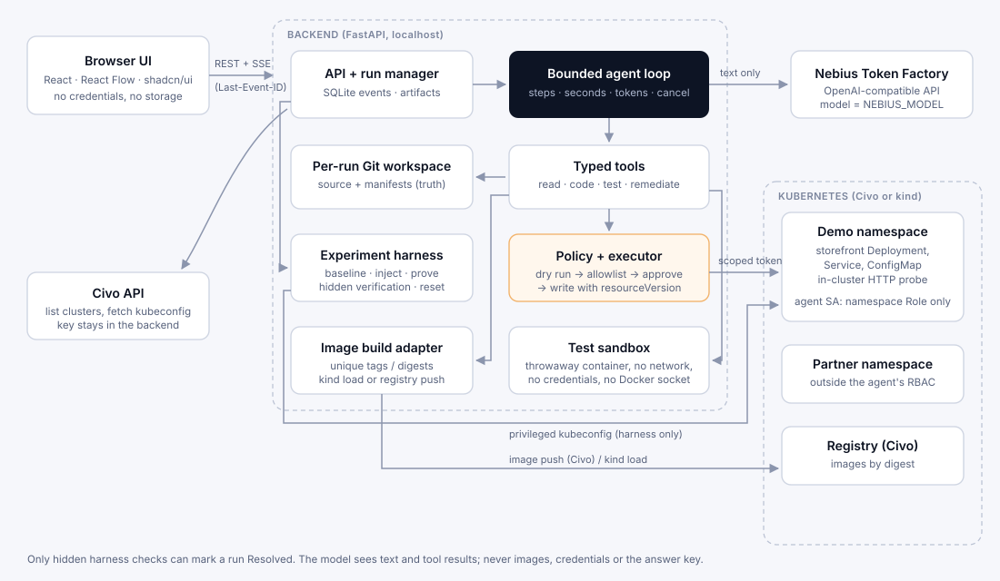

# KubeTrace AI

Kubernetes incident investigation and remediation by a bounded tool-calling agent, with inference on **Nebius Token Factory**, demonstrated on a **Civo** Kubernetes cluster. Inspired by [HolmesGPT](https://github.com/HolmesGPT/holmesgpt).

**Issue → evidence → agent tool actions → code or manifest patch → tests → deployment → recovery verification → what worked and what failed.**



> **Model status (checked 2026-10-16).** The project targets Reflection **Beam** through Token Factory, but Beam is **not in the Token Factory catalog yet**: the provider preflight lists 26–27 models and none is Beam. Live verification with Beam is **pending**. All live runs so far use **Muse Spark Open** (`meta-models/muse-spark-open`), chosen by the project owner, and every report names that model. Switching is one setting, `NEBIUS_MODEL`, once Beam appears in `GET /v1/models`. Nothing in this repository claims Beam produced a result.

## What it does

1. Connects to a cluster: a kubeconfig context, or a Civo cluster fetched server-side through the Civo API.
2. Shows live workloads and health, with a topology that separates API-observed relationships (EndpointSlices, ownerReferences) from inferred ones (selector matches).
3. Deploys a small storefront checkout service, then injects one real fault from the catalog and proves it is visible.
4. Lets the agent investigate with typed tools, through a namespace-scoped ServiceAccount: logs, events, rollout state, endpoints, HTTP checks through the Service, and source reading.
5. The agent proposes code or manifest patches. A deterministic executor dry-runs each one on the API server, checks it against a policy allowlist, waits for approval in review mode, and writes it with a staleness check.
6. For code bugs: tests in a disposable sandbox (no network, no credentials), an immutable image build, deploy, rollout.
7. Hidden harness checks, which the agent never sees, decide whether the run is **Resolved**. The agent's own claim never does.
8. A report covers every attempt, including denied changes and failed checks, with diffs, test output, tokens and timings. Export it as Markdown or JSON, and replay it later.

## Quick start (local kind cluster)

Requirements: macOS or Linux, Docker, kind, Python 3.11+ with [uv](https://docs.astral.sh/uv/), Node 22 with pnpm.

```bash
cp .env.example .env            # set NEBIUS_API_KEY (and NEBIUS_MODEL); leave the rest for kind
kind create cluster --config deploy/kind/kind-config.yaml --kubeconfig .secrets/kind-kubeconfig
echo "KUBECONFIG=$PWD/.secrets/kind-kubeconfig" >> .env

uv sync
uv run kubetrace preflight      # checks auth, model access and the tool-calling round trip
(cd apps/web && pnpm install && pnpm build)
uv run kubetrace serve          # http://127.0.0.1:8000
```

Then open the **Experiments** tab, choose a scenario, and press **Setup**, then **Inject**, then **Investigate**. Turn off **Live model** to run the labelled fixture (a scripted stand-in, no model called).

For UI development, run `pnpm dev` in `apps/web` (http://127.0.0.1:5173, which proxies `/api` to the API). Headless use: `uv run kubetrace run application-bug --model-mode live`.

Docker Compose (`docker compose up --build`) works for Civo clusters. For kind on macOS, run the API on the host, because a container cannot reach the kind API server on the host's 127.0.0.1.

## Connect your Civo cluster

See [docs/CIVO.md](docs/CIVO.md). In short: set `CIVO_API_KEY`, `CIVO_REGION`, `CIVO_CLUSTER_ID`, `CLUSTER_KIND=civo` and a `REGISTRY` that the nodes can pull from, then connect from the **Connection** panel or let the API connect on start. KubeTrace never creates Civo infrastructure.

## Experiments

| Scenario | Fault | Repair | Success needs (hidden checks) |
|---|---|---|---|
| `selector-mismatch` | Service selector matches no Pods | manifest | selector matches the Pods, endpoints ready, real checkouts through the Service, manifest equals live |
| `application-bug` (flagship) | 30+ unit orders crash pricing (HTTP 500) | code | new image built in the run is deployed; hidden pricing tests pass; 6 checkout totals correct; no exception swallowing; the agent's regression test fails on the buggy code; original tests kept |
| `broken-readiness` | readiness probe path `/ready` (404) | manifest | probe is `httpGet /readyz` (not exec, not removed), rollout complete, Pods Ready, checkout works |
| `invalid-config` | `tax_rate: "8%"`: startup crash | config | `tax_rate` 0.08, other keys untouched, Pods stable, totals correct |
| `memory-pressure` | cache 160 MiB, limit 128 MiB: OOMKilled | config or bounded resources | limit fits the cache, at most 2× what it needs; Pods stable |
| `partner-outage` | payment partner (another namespace) down | none: escalate | agent escalates, names the gateway, applies no change, claims no recovery |

## Results

Only from recorded runs; produced by `scripts/results_table.py`. Every attempt counts, including failures. These are small demo scenarios, not SWE-bench or Terminal-Bench results, and repeated runs of one scenario are not separate capabilities. See [docs/RESULTS.md](docs/RESULTS.md) for the current table and sample reports.

## Documentation

- [docs/CIVO.md](docs/CIVO.md): Civo setup, registry, cleanup
- [docs/COOKBOOK.md](docs/COOKBOOK.md): each scenario as issue → actions → patch → tests → outcome
- [docs/RECORDING_SCRIPT.md](docs/RECORDING_SCRIPT.md): a three-experiment demo recording
- [docs/SECURITY.md](docs/SECURITY.md): credentials, RBAC, policy, sandboxing, remote exposure
- [docs/TESTING.md](docs/TESTING.md): what is tested and how to run it
- [docs/TROUBLESHOOTING.md](docs/TROUBLESHOOTING.md): common problems and cleanup
- [docs/PLAN.md](docs/PLAN.md): verified provider facts and the build plan

## Design notes

- **No agent framework.** An explicit loop (`services/agent/kubetrace_agent/loop.py`) with Pydantic tool schemas, the same approach HolmesGPT takes with its own `ToolCallingLLM` engine. The official `openai` SDK talks to Token Factory's OpenAI-compatible endpoint.
- **No private reasoning is shown.** The timeline shows the model's short visible decision notes, its tool calls and results, and its `note` tool entries (observations and hypotheses). Provider reasoning fields are never stored.
- **The model sees text only:** tool results and repository text, redacted and size-limited, and treated as untrusted data. It never sees credentials, the hidden checks or the expected patch.

Licensed under [Apache-2.0](LICENSE).
